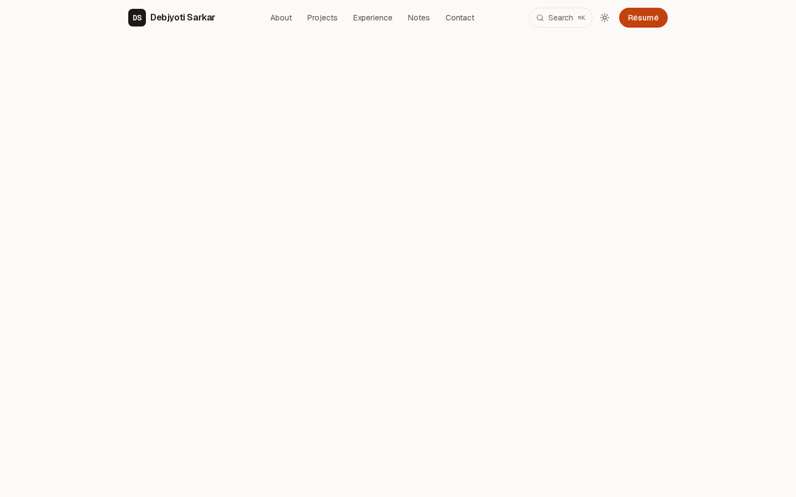
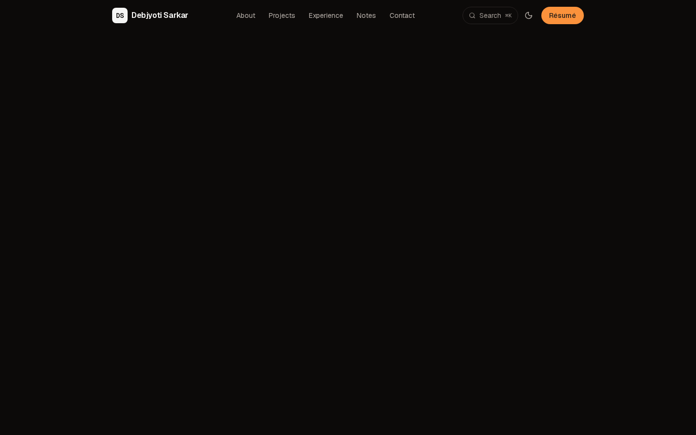
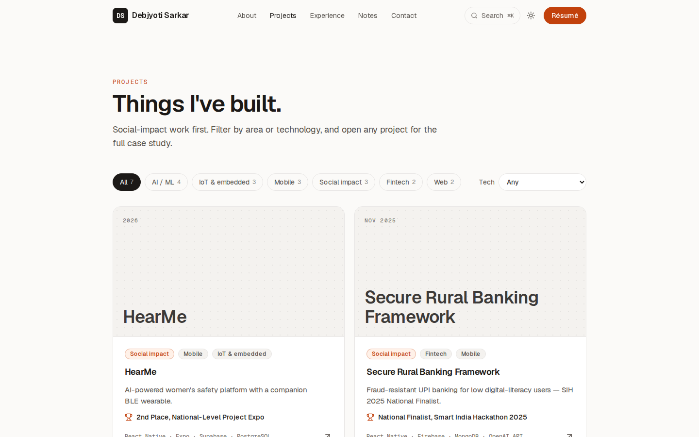
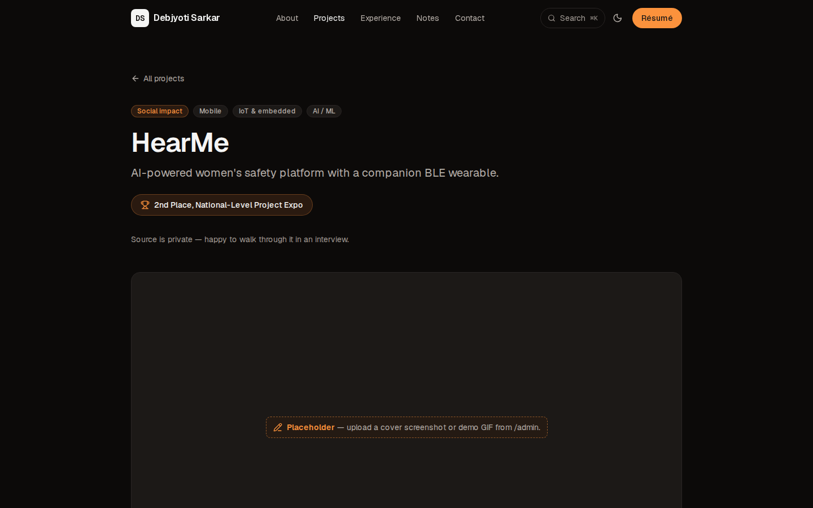

# Debjyoti Sarkar — Portfolio

[](https://github.com/Debjyoti-sarkar/Portfolio-Me/actions/workflows/ci.yml)

Personal site and case-study portfolio of **Debjyoti Sarkar (Deb)** — software engineer building secure, real-time
systems for safety, finance and accessibility.

**Live:** https://debjyoti-sarkar.vercel.app

**Stack:** Next.js 16 (App Router, Cache Components) · TypeScript (strict) · Tailwind CSS v4 · Motion · Supabase
(Postgres + RLS, Auth, Storage, Edge Functions) · Resend · Vitest · Playwright · GitHub Actions · Vercel

| Light                                                      | Dark                                                     |
| ---------------------------------------------------------- | -------------------------------------------------------- |
|  |  |
|     |     |

---

## Features

- **Content from the database.** Projects, skills, experience, achievements and notes live in Supabase and are
  edited from a private `/admin` dashboard — nothing is hard-coded in components.
- **Case studies** for every project (problem → role → architecture → challenges → results → media), with filtering by
  category and technology. Social-impact work is listed first.
- **Fast by default.** Public pages are prerendered into a static shell and cached with `'use cache'`; edits in
  `/admin` refresh them instantly via `updateTag`. If the database is ever unreachable, visitors still get the last
  good version.
- **Accessible.** Semantic landmarks, skip link, visible focus ring, keyboard-only navigation, AA-contrast tokens in both
  themes, `prefers-reduced-motion` respected everywhere, content readable without JavaScript. Automated axe checks
  run in CI.
- **Polish.** Light/dark/system theme, ⌘K / Ctrl+K command palette, subtle scroll reveals, generated OG images.
- **Secure.** RLS on every table, owner-only admin, service-role key never shipped, strict security headers (CSP,
  HSTS, frame-ancestors), validated + rate-limited + honeypot-protected contact form.
- **Privacy-friendly analytics.** First-party events (page views, résumé downloads, outbound clicks) — no cookies, no
  IPs, no user agents, Do-Not-Track honoured.

## Architecture

```mermaid
flowchart LR
  subgraph Browser
    UI["Next.js pages<br/>(static shell + client islands)"]
    Form["Contact form<br/>(RHF + Zod)"]
    Admin["/admin dashboard"]
  end

  subgraph Vercel["Vercel (free Hobby plan)"]
    RSC["Server Components<br/>'use cache' + cacheTag"]
    Proxy["proxy.ts<br/>session refresh for /admin"]
    Actions["Server Actions<br/>requireAdmin() + Zod"]
    Events["/api/events<br/>analytics sink"]
  end

  subgraph Supabase["Supabase (free tier, shared with HearMe)"]
    PG[("Postgres · schema portfolio<br/>RLS on every table")]
    Auth["Auth<br/>(admin allow-list)"]
    Storage["Storage<br/>portfolio-media · portfolio-documents"]
    Fn["Edge Function: portfolio-contact<br/>validate · honeypot · rate-limit"]
  end

  Resend["Resend<br/>email notification"]

  UI --> RSC -->|publishable key, published rows| PG
  UI --> Events -->|insert-only| PG
  Form -->|POST| Fn -->|service role| PG
  Fn --> Resend
  Admin --> Proxy --> Actions -->|user JWT, is_admin()| PG
  Actions -. updateTag .-> RSC
  Admin -->|upload| Storage
  Actions --> Auth
```

### Security model

| Table                                   | Public (anon)                                            | Admin                    |
| --------------------------------------- | -------------------------------------------------------- | ------------------------ |
| `projects`, `blog_posts`                | read **published** rows                                  | full CRUD                |
| `skills`, `experiences`, `achievements` | read                                                     | full CRUD                |
| `contact_messages`                      | **none** — only the Edge Function (service role) inserts | read, mark read, delete  |
| `analytics_events`                      | insert (CHECK-constrained), no read                      | read                     |
| `admins`                                | none                                                     | read                     |
| Storage `portfolio-media`, `-documents` | read                                                     | upload / update / delete |

All tables live in a dedicated **`portfolio` schema**, so the site shares a Supabase project with the HearMe app
without touching HearMe's `public` schema, buckets or auth settings. Having a Supabase account grants nothing:
`portfolio.is_admin()` (SECURITY DEFINER) checks the caller against the `portfolio.admins` allow-list, managed with
`npm run admin:create` (which never changes an existing user's password unless `RESET_PASSWORD=1`). Authorization is
enforced three times: `proxy.ts` (optimistic redirect), `requireAdmin()` in every Server Action/page, and Postgres RLS.

## Project structure

```
src/
  app/
    (site)/              public pages: home, /projects, /projects/[slug], /notes, /notes/[slug]
    admin/               login + dashboard (projects, notes, messages, analytics)
    api/events/          privacy-friendly analytics endpoint
    sitemap.ts robots.ts manifest.ts opengraph-image.tsx icon.tsx
  components/            layout/ sections/ projects/ admin/ ui/
  lib/
    data/content.ts      cached data access ('use cache' + cacheTag)
    supabase/            public, session and browser clients + generated types
    auth.ts              Data Access Layer (requireAdmin)
    validation/          Zod schemas for admin forms
  proxy.ts               session refresh + /admin gate
supabase/
  migrations/            portfolio schema, RLS policies, storage buckets
  seed.sql               initial content (sourced from résumé + project READMEs)
  functions/portfolio-contact/  Edge Function (Deno)
  functions/_shared/     contact schema + helpers shared with the Next.js form
tests/
  unit/                  Vitest
  e2e/                   Playwright (navigation, a11y, contact, admin, RLS)
```

## Getting started

Requirements: Node 20.9+ (22 recommended), Docker, [Supabase CLI](https://supabase.com/docs/guides/cli).

```bash
npm install
npm run db:start                 # local Supabase: applies migrations + seed
supabase status                  # copy API URL + publishable key
cp .env.example .env.local       # paste them in, plus the service-role key for the admin script
cp supabase/functions/.env.example supabase/functions/.env

ADMIN_EMAIL=you@example.com ADMIN_PASSWORD='a-long-password' npm run admin:create
npm run functions:serve          # contact Edge Function (separate terminal)
npm run dev                      # http://localhost:3000  ·  admin: /admin
```

Local Supabase Studio runs at http://127.0.0.1:54323 and captured auth emails at http://127.0.0.1:54324.

## Scripts

| Script                                      | What it does                                                                |
| ------------------------------------------- | --------------------------------------------------------------------------- |
| `npm run dev` / `build` / `start`           | Next.js dev server / production build / serve the build                     |
| `npm run lint`                              | ESLint (Next.js + React Compiler rules), zero warnings allowed              |
| `npm run typecheck`                         | Generate route types and run `tsc --noEmit` (strict)                        |
| `npm run format` / `format:check`           | Prettier (with Tailwind class sorting)                                      |
| `npm test`                                  | Vitest unit tests                                                           |
| `npm run test:e2e`                          | Playwright against a production build (needs local Supabase)                |
| `npm run check`                             | lint + typecheck + format check + unit tests                                |
| `npm run db:start` / `db:stop` / `db:reset` | Manage the local Supabase stack                                             |
| `npm run db:types`                          | Regenerate `src/lib/supabase/database.types.ts` from the schema             |
| `npm run functions:serve`                   | Run Edge Functions locally                                                  |
| `npm run admin:create`                      | Create/promote the single admin account (uses the service-role key locally) |

## Deployment (100% free tier)

Production runs on **Vercel Hobby** (`main` → production, every other branch → preview) and the **HearMe Supabase
project** (`portfolio` schema). See **[docs/DEPLOYMENT.md](docs/DEPLOYMENT.md)** for how it was set up, how to ship
schema changes, the contact-form secrets, Resend, and (optionally) a custom domain.

## CI

`.github/workflows/ci.yml` runs on every push and PR:

1. **quality** — `npm ci`, ESLint, type-check, Prettier check, unit tests.
2. **build-e2e** — starts Supabase in Docker (migrations + seed), checks generated types are current, serves the Edge
   Function, creates a CI admin, builds the site and runs the Playwright suite (desktop 1440px + mobile 360px), including
   axe accessibility scans and RLS checks.

`.github/workflows/supabase-keepalive.yml` can ping the production database every 3 days so a free project never pauses
(it only runs when the `SUPABASE_URL` repository variable is set).

## License

MIT — see [LICENSE](LICENSE). Project write-ups and the photo are © Debjyoti Sarkar.
